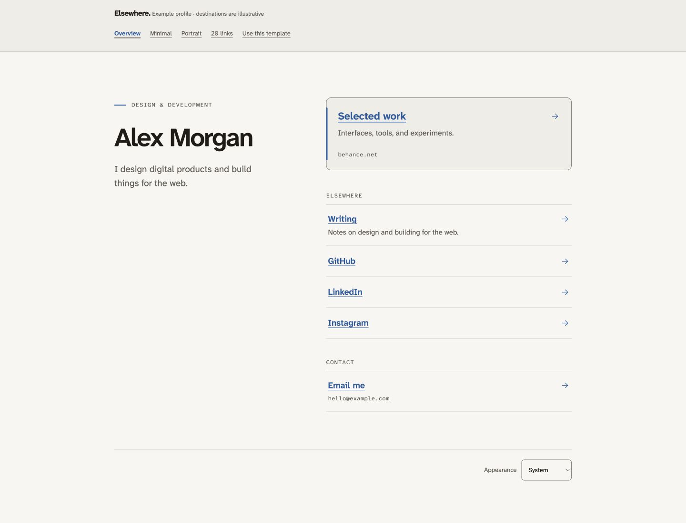

# Elsewhere

A considered place to be found. A small, portable profile and links template, informed by the design approach behind [Quiet](https://github.com/hjadmz/quiet).

**Version 1.1.0 — reusable static template.** Design direction follows Henry Adams’s supplied principles; implementation and documentation were developed with AI assistance. The example person is fictional. Example links lead to platform homepages; `hello@example.com` is an illustrative address. Replace all sample content before using it as your own site.



[Download the latest release](https://github.com/hjadmz/elsewhere/releases/latest) · [Customization](docs/CUSTOMIZATION.md) · [Hosting](docs/HOSTING.md)

## What it does

- Introduces a person and a collection of links, with an optional featured destination and portrait.
- Supports any platform through a label and URL—no social-media registry to maintain.
- Handles a short list or a larger directory through optional groups, ordinary scrolling, and browser Find. By default, a Sections menu appears when at least three titled groups contain at least twelve links in total.
- Offers paper/stone palettes, blue/rust/forest accents, and system/light/dark appearance.
- Generates semantic HTML. All content and navigation work without JavaScript. The small optional script adds a theme preference and a broken-image fallback.
- Self-hosts fonts. No application server, runtime framework, third-party embeds, or analytics are included.

No public template credit is required. The footer is yours. Source code is MIT licensed; bundled Atkinson fonts retain their SIL OFL notices. The sample illustration is original template artwork. Personal identity marks are not included.

## Try it

Use Node.js 22 or newer. There are no npm packages to install.

```sh
npm test
npm run build
npm start
```

Open the printed local address, normally `http://127.0.0.1:4173`. The server only binds to your own computer. Run `npm run build` and reload after editing. The sample navigation shows the main example, a minimal profile, a portrait, and twenty links.

After building, `dist/index.html` also opens directly from disk. GitHub source downloads and clones need this build step; the release ZIP includes prebuilt demonstration files. Core links and layout work in that mode; browser storage behavior for file URLs varies.

## Make it yours

Copy `starter.json` into **`profile.json`** for a clean starting point, or edit the demonstration profile. A small complete example:

```json
{
  "name": "Your name",
  "bio": "A sentence about you.",
  "groups": [{
    "title": "Find me",
    "links": [
      {"label": "My work", "url": "https://example.com/work"},
      {"label": "Email me", "url": "mailto:hello@example.com"}
    ]
  }],
  "appearance": {"palette": "paper", "accent": "blue", "theme": "system"},
  "demo": false
}
```

Set `demo` to `false` for your site. This removes the demonstration bar, generated example pages, guide, and demo `noindex` directive. Files you explicitly put in `public/` are published; keep that folder limited to intended public assets.

| Field | Meaning |
|---|---|
| `name` | Required, visible page heading. |
| `eyebrow`, `bio`, `location`, `footer` | Optional plain text. Delete or leave blank to omit. Bio supports `\n` line breaks. |
| `portrait` | Optional `{ "src": "assets/portrait.webp", "alt": "…" }`. Place the file in `public/assets/`. Omit the entire object for no portrait. An empty alt is appropriate when it repeats the adjacent identity. |
| `featured` | Optional `{ "label": "…", "url": "…", "description": "…" }` for one priority destination. |
| `groups` | Array of `{ "title": "…", "links": […] }`. Titles and link descriptions are optional. Delete empty groups. Use `[]` for a featured-only page. |
| `sections` | Optional `auto` (default), `on`, or `off`. Use `on` for a long directory with at least two titled groups or `off` when scrolling is enough. |
| `links` | Any number of `{ "label": "…", "url": "…", "description": "…" }` records. Descriptions are optional; add `"destination": true` to show a hostname or address. Array order is display/keyboard order. |
| `appearance.palette` | `paper` (warm) or `stone` (cool). |
| `appearance.accent` | `blue`, `rust`, or `forest`. Colors are paired with light/dark backgrounds. |
| `appearance.theme` | `system`, `light`, or `dark` initial preference. A visitor can override it. |
| `site` | Optional `title`, `description`, `url` (canonical page URL), `image` (local sharing image; requires `url`), and `favicon` (local SVG, PNG or ICO). Keep a trailing slash for directory URLs. |
| `lang`, `direction` | Language tag (default `en`) and `ltr`, `rtl`, or `auto` (default). System fallback fonts cover characters absent from the bundled fonts. Translate interface labels through `labels` when changing language. |
| `labels` | Optional `lang`, `skipLink`, `sections`, `appearance`, `system`, `light`, and `dark` interface strings. Unspecified labels remain English and retain their English language tag. |
| `demo` | `true` only for the preview gallery. Defaults to `false` if omitted. |

Links support `https:`, `http:`, `mailto:`, `tel:`, and ordinary local paths. Use complete URL schemes for external sites. Optional destination text shows the hostname or contact address. Links open in the current tab. Visitors can use their browser to open another tab. URL credentials, unsafe schemes, control characters, and parent-directory traversal are rejected. Plain text is escaped; raw HTML in config is not interpreted.

The build gives a specific field path when a configuration value is invalid. Fix the reported value and rebuild. Invalid configuration or missing local images leave the previous `dist/` intact. JSON is intentionally a small authoring surface, not a browser-based editing service. Use the included examples as starting points. Back up your source or keep it in Git; `dist/` is generated and is replaced on a successful build.

Full examples: [customization](docs/CUSTOMIZATION.md) · [hosting and Jekyll coexistence](docs/HOSTING.md).

## Host it anywhere static files work

Upload the **contents of `dist/`** to your static host. Node is only needed for editing/building; the published page needs no Node server. Relative asset paths support hosting at a domain root or repository subpath. Use relative local destination paths if the site may move between them. Your host may keep request logs; the absence of template analytics is not a promise about your host.

For a **new GitHub repository**, copy the source package, select **Settings → Pages → GitHub Actions**, and run the included **Publish to GitHub Pages** workflow manually. It tests, builds, and uploads `dist/`. Automatic publication is intentionally not triggered by a push; you can add that later. See [GitHub’s custom workflow documentation](https://docs.github.com/en/pages/getting-started-with-github-pages/using-custom-workflows-with-github-pages). The included workflow is optional; creating a repository does not automatically publish a website.

Do not copy an unrelated `.openai/hosting.json` or `.git/` directory into your own repository. The downloadable source package excludes preview-host identity. No Sites account is required to use the template. The private demonstration may require sign-in; the exported static site contains no authentication layer.

## Check a release

`npm test` checks rendering, configuration, all supplied colors, enhancement behavior, and complete root/subpath asset resolution without requiring a network. `npm run test:hosting` additionally serves temporary copies over loopback HTTP and checks every referenced asset and local page. It needs permission to open a local port. Neither command contacts destination social accounts.

The build has no npm dependencies. Source files are small ES modules, CSS, and JSON. The repository includes tests, the manual GitHub Pages workflow, and licenses. Release ZIPs also include prebuilt demonstration files. Hosting-specific behavior still needs checking on the chosen provider.

## Design and accessibility

Read [the design rationale](docs/DESIGN.md) for the FCA reasoning, Norman/Rams influences, alternatives, research, and the choice to group twenty links rather than hide them. Read [the accessibility checks and verification scope](docs/ACCESSIBILITY.md) before describing the template as accessible.

The goal is WCAG 2.2 AA. Provided colors are tested mathematically. Layout, semantics and behavior still need checks with real content, browsers and assistive technology. Custom CSS can undo the safeguards. Start with the available palettes; if extending them, run contrast tests and keyboard/reflow checks.

There is no custom cursor, drag interaction, obligatory animation, account system, database, analytics dashboard, embedded feed, or live social-platform integration. If browser editing, several managed profiles, or analytics become essential, reassess whether a hosted service fits better.

## Keeping an existing blog

Treat this as a separate site until you choose to migrate. Preserve the blog repository, Markdown posts, assets, domain configuration, canonical URLs, redirects, and feed identity. A homepage replacement does not automatically preserve old URLs. Create and test a restoration plan before changing hosting. Keep that migration separate from adopting this template.
